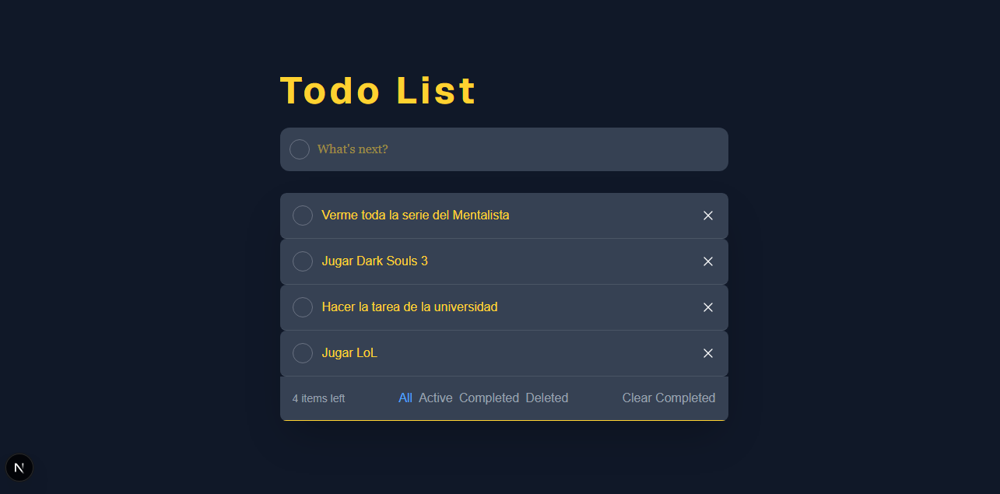

 # 📝 Todo List — BPDS

<p align="center">
  
  
  
  
</p>

A to-do list application (**full CRUD**) built with **Next.js**, **TypeScript**, and **Tailwind CSS**, developed as a team for the Software Development course.

<p align="center">



</p>

---

## 📑 Contents

- [Installation](#-installation)
- [Run the project](#️-run-the-project-locally)
- [Features](#-main-features)
- [Team members](#-team-members)
- [Technologies](#️-technologies-used)

---

## 🚀 Installation

Clone the repository and install the project dependencies:

```bash
git clone https://github.com/ChrisAltF4/BPDS.git
cd BPDS
npm install
```

## ▶️ Run the project locally

Once the dependencies are installed, start the development server:

```bash
npm run dev
```

Then open your browser at **[http://localhost:3000](http://localhost:3000)** to see the application running.

---

## ✨ Main features

The application implements the full **CRUD** cycle on tasks, along with a filter system and a trash for deleted tasks.

| Feature | Description |
|---|---|
| ➕ **Create** | Type in the text field and press **Enter** to add a task (no button needed). |
| 📋 **Read** | All tasks are automatically displayed in the main list. |
| ✅ **Update (cross out)** | Click the circle on each task to mark it as completed. It gets crossed out visually, **without being deleted**. |
| ✏️ **Update (edit)** | Click on a task's text to edit it in place. The change is saved automatically when you click outside the field (no "save" button). |
| ❌ **Delete** | The **✕** button on each task removes it completely from the main list. |
| 🔍 **Filters** | **All / Active / Completed / Deleted** buttons to view only the tasks in each category. |
| 🗑️ **Deleted tasks trash** *(new feature)* | When a task is deleted, its name is saved to a history. You can view it from the **Deleted** tab, which shows only the names (no option to restore them). |
| 🧹 **Clear Completed** | Deletes all tasks already marked as completed in one go. |
| 🔢 **Task counter** | Shows how many tasks are still pending ("X item left"). |

---

## 🛠️ Technologies used

- [Next.js](https://nextjs.org/) (App Router)
- [TypeScript](https://www.typescriptlang.org/)
- [Tailwind CSS](https://tailwindcss.com/)
- [React](https://react.dev/) (useState, useEffect)
